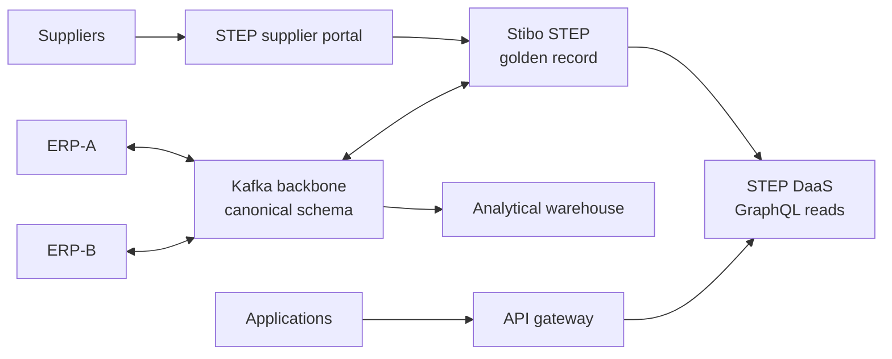

# Product MDM on Stibo STEP — Reference Architecture

A production-ready reference architecture for product master data management, with Stibo STEP as the MDM platform and Kafka as the integration backbone. The scenario is **FreshLine Foods**, a fictional food distributor whose product data is split across two ERPs and supplier submissions that arrive by spreadsheet and email.

> All content is based on a fictional company and public vendor documentation. Nothing is taken from any employer's implementation.

## The problem

Product data is created in places that disagree: a legacy ERP, an ERP inherited through acquisition, and suppliers sending new items by email. Duplicates, conflicting attributes and slow new-item setup delay sales and cause ordering errors.

## The architecture in one picture



ERPs and bulk consumers connect through Kafka, applications read through DaaS, and suppliers work inside STEP's own portal, so STEP's core is never coupled directly to the systems around it. [Full diagram](docs/diagrams/context.md).

## Key decisions

| ADR | Decision |
| --- | --- |
| [0001](docs/adr/0001-mdm-implementation-style.md) | Centralized MDM for new items; consolidation for legacy items during migration |
| [0002](docs/adr/0002-kafka-integration-backbone.md) | Kafka between STEP, the ERPs and bulk consumers; no point-to-point links |
| [0003](docs/adr/0003-canonical-product-schema.md) | One canonical, versioned product schema at the STEP boundary |
| [0004](docs/adr/0004-daas-for-product-data-access.md) | Stibo DaaS for on-demand, high-volume reads |
| [0005](docs/adr/0005-step-hosting.md) | Vendor-hosted STEP SaaS |
| [0006](docs/adr/0006-erp-write-back-via-adapters.md) | Golden data written back to ERPs by adapters, not by STEP |
| [0007](docs/adr/0007-step-supplier-portal.md) | STEP supplier portal for supplier onboarding |

## Repository contents

```
docs/
  architecture.md      full reference architecture
  diagrams/context.md  context diagram (Mermaid)
  adr/                 architecture decision records + template
```

## Roadmap

STEP and DaaS are licensed software, so this repo builds the integration layer *around* them and uses small stand-ins where they would sit: a **STEP stand-in** that consumes the inbound topic and publishes golden events in the canonical schema, and a **DaaS stand-in** that serves golden records through GraphQL. Swapping either for the real product would not change any other component, which is the point of the design.

- [x] **Phase 0 — Architecture:** reference architecture, context diagram, ADRs
- [ ] **Phase 1 — Contracts:** canonical product schema (Avro), topic design, schema registry with compatibility rules
- [ ] **Phase 2 — Inbound:** mock ERP-A and ERP-B producers and their adapters to the canonical schema
- [ ] **Phase 3 — STEP stand-in:** consumes inbound events, publishes golden events, dead-letter handling
- [ ] **Phase 4 — Outbound:** ERP write-back adapters, analytical warehouse loader (history + current-state tables)
- [ ] **Phase 5 — Reads:** DaaS stand-in with GraphQL, behind an API gateway with OAuth client credentials
- [ ] **Phase 6 — Run it:** docker-compose, `make demo`, CI, observability

## License

MIT
