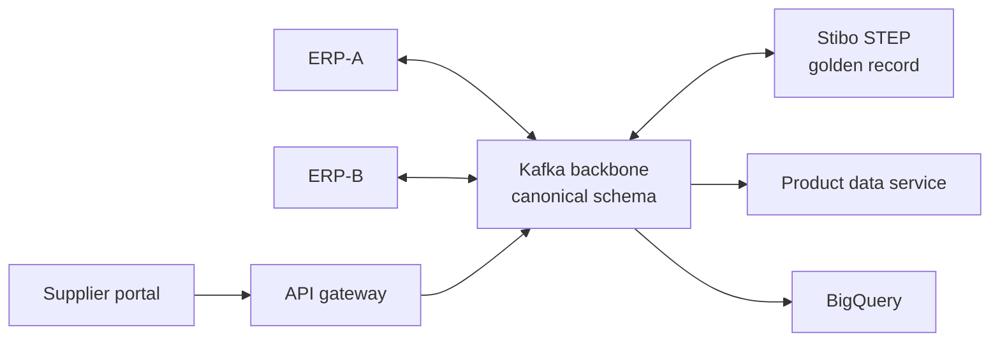

# Product MDM on Stibo STEP — Reference Architecture

A production-ready reference architecture for product master data management, with Stibo STEP as the MDM platform and Kafka as the integration backbone. The scenario is **FreshLine Foods**, a fictional food distributor whose product data is split across two ERPs and a supplier onboarding portal.

> All content is based on a fictional company and public vendor documentation. Nothing is taken from any employer's implementation.

## The problem

Product data is created in three places that disagree: a legacy ERP, an ERP inherited through acquisition, and a supplier portal. Duplicates, conflicting attributes and slow new-item setup delay sales and cause ordering errors.

## The architecture in one picture



No system talks to STEP directly, so STEP can be upgraded, scaled or replaced without touching sources or consumers. [Full diagram](docs/diagrams/context.md).

## Key decisions

| ADR | Decision |
| --- | --- |
| [0001](docs/adr/0001-mdm-implementation-style.md) | Centralized MDM for new items; consolidation for legacy items during migration |
| [0002](docs/adr/0002-kafka-integration-backbone.md) | Kafka between STEP and every system, no point-to-point links |
| [0003](docs/adr/0003-canonical-product-schema.md) | One canonical, versioned product schema at the STEP boundary |
| [0004](docs/adr/0004-product-data-service.md) | Separate read model for high-volume lookups |
| [0005](docs/adr/0005-step-hosting.md) | Vendor-hosted STEP SaaS |
| [0006](docs/adr/0006-erp-write-back-via-adapters.md) | Golden data written back to ERPs by adapters, not by STEP |

## Repository contents

```
docs/
  architecture.md      full reference architecture
  diagrams/context.md  context diagram (Mermaid)
  adr/                 architecture decision records + template
```

## Roadmap

STEP is licensed software, so this repo builds everything *around* it and uses a small **STEP stand-in** that consumes the inbound topic and publishes golden events in the canonical schema. Swapping the stand-in for real STEP endpoints would not change any other component, which is the point of the design.

- [x] **Phase 0 — Architecture:** reference architecture, context diagram, ADRs
- [ ] **Phase 1 — Contracts:** canonical product schema (Avro), topic design, schema registry with compatibility rules
- [ ] **Phase 2 — Inbound:** mock ERP-A and ERP-B producers and their adapters to the canonical schema
- [ ] **Phase 3 — Supplier API:** submission API behind a gateway, service-account auth with a signed supplier claim, per-supplier throttling
- [ ] **Phase 4 — STEP stand-in:** consumes inbound events, publishes golden events, dead-letter handling
- [ ] **Phase 5 — Outbound:** product data service, ERP write-back adapters, BigQuery sink
- [ ] **Phase 6 — Run it:** docker-compose, `make demo`, CI, observability

## License

MIT
