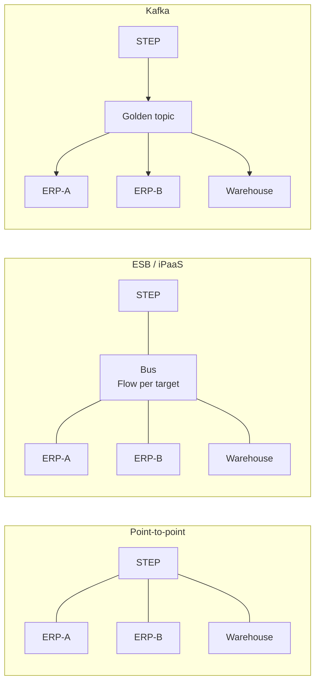

# ADR-0002: Kafka as the integration backbone

- **Status:** Accepted
- **Date:** 2026-10-18 (options expanded 2026-10-20)

## Context

STEP must exchange product data with two ERPs and several downstream consumers. Each ERP has its own formats, keys and availability windows, and new consumers will be added over time. The integration approach decides how hard it is to add a system, recover from a failure, and see what happened to a product change.

## Options considered

### 1. Point-to-point integrations

STEP connects directly to each ERP and consumer, with a dedicated export or import per system.

- **Strengths:** simplest to start; no extra platform to run.
- **Weaknesses:** every new system adds integrations at both ends, so the number of links grows quickly. Each link has its own format, retry logic and monitoring. STEP becomes coupled to every system's availability and changes.

### 2. An ESB or iPaaS orchestrating every flow

An **Enterprise Service Bus (ESB)** is a central integration platform, usually self-hosted (for example MuleSoft, IBM App Connect, TIBCO or webMethods), that receives messages, transforms them, routes them and calls the target systems. An **Integration Platform as a Service (iPaaS)** is the cloud-hosted equivalent (for example MuleSoft Anypoint, Boomi or Azure Logic Apps), with prebuilt connectors and low-code mapping.

In both, the integration logic lives in the middle: the platform knows every source, every target and how to translate between them. This is often called "smart pipes".

- **Strengths:** prebuilt connectors to common ERPs and SaaS applications; visual mapping that non-specialists can maintain; strong for request-response and orchestrated multi-step flows; mature monitoring for each flow.
- **Weaknesses:**
  - The central platform and its team become a bottleneck: every change to any flow goes through them.
  - Flows are typically one source to one or a few targets. Adding a consumer means building or changing a flow, rather than simply subscribing.
  - Messages are usually deleted once delivered, so replaying past changes to a new or recovering consumer is hard.
  - Licensing is often priced by connector, flow or throughput, which grows with product data volume.
  - Business logic leaks into the middleware, away from the systems that own it.

### 3. Kafka as an event backbone

STEP and the ERPs publish changes to Kafka topics, and each consumer subscribes to the topics it needs. STEP connects through its native Kafka inbound and outbound endpoints. Translation happens in small adapters at the edges, and Kafka itself only stores and delivers events. This is often called "smart endpoints, dumb pipes".

- **Strengths:** one golden event serves any number of consumers; new consumers subscribe without changing STEP or other consumers; events are retained, so consumers can replay history to recover or bootstrap; consumers are decoupled from each other's availability.
- **Weaknesses:** more moving parts than direct integration; needs Kafka skills, schema governance and clear topic ownership; request-response interactions need a separate path (here, DaaS through the API gateway).

## Decision

Kafka between STEP, the ERPs and bulk consumers. No ERP or bulk consumer integrates with STEP directly.

The main reason is the shape of master data distribution: one golden record change must reach many consumers, reliably and repeatably, and new consumers will keep appearing. A durable, replayable publish-subscribe log fits that better than orchestrated flows.

### Why Kafka rather than an ESB or iPaaS

An ESB removes point-to-point *connections*, but not necessarily point-to-point *logic*. Each system connects once to the bus, in a hub-and-spoke shape. Inside the bus, though, integrations are usually built as one flow per source and target, each with its own mapping and routing. Adding a consumer still means building a new flow, often by a central team.

ESBs can publish to multiple subscribers, but two properties that matter for master data distribution are typically missing or limited:

| Need | ESB / iPaaS | Kafka |
| --- | --- | --- |
| Add a new consumer | Build or change a flow in the central platform | Consumer subscribes to the golden topic itself |
| Recover or bootstrap a consumer | Messages are usually gone once delivered; needs a re-export from STEP | Replay retained events from any point |
| Where routing rules live | Centrally, in the bus (content-based routing) | At the edges: each ERP adapter filters what it needs, or a routing service writes target-specific topics |
| Cost growth | Often priced per connector, flow or throughput | Grows with infrastructure, not with the number of consumers |

ESBs and iPaaS remain stronger for orchestrated, request-response flows and for connecting many SaaS applications with prebuilt connectors. Neither is the main need here.

## Consequences

- One place to publish, monitor and replay product changes
- Adding a consumer means a new subscription, not a new integration from STEP
- More moving parts than direct integration
- Requires schema governance (ADR-0003) and clear topic ownership
- An ESB or iPaaS is not ruled out at the edges: an ERP write-back adapter (ADR-0006) could use one where a prebuilt ERP connector saves effort, while Kafka stays the backbone
