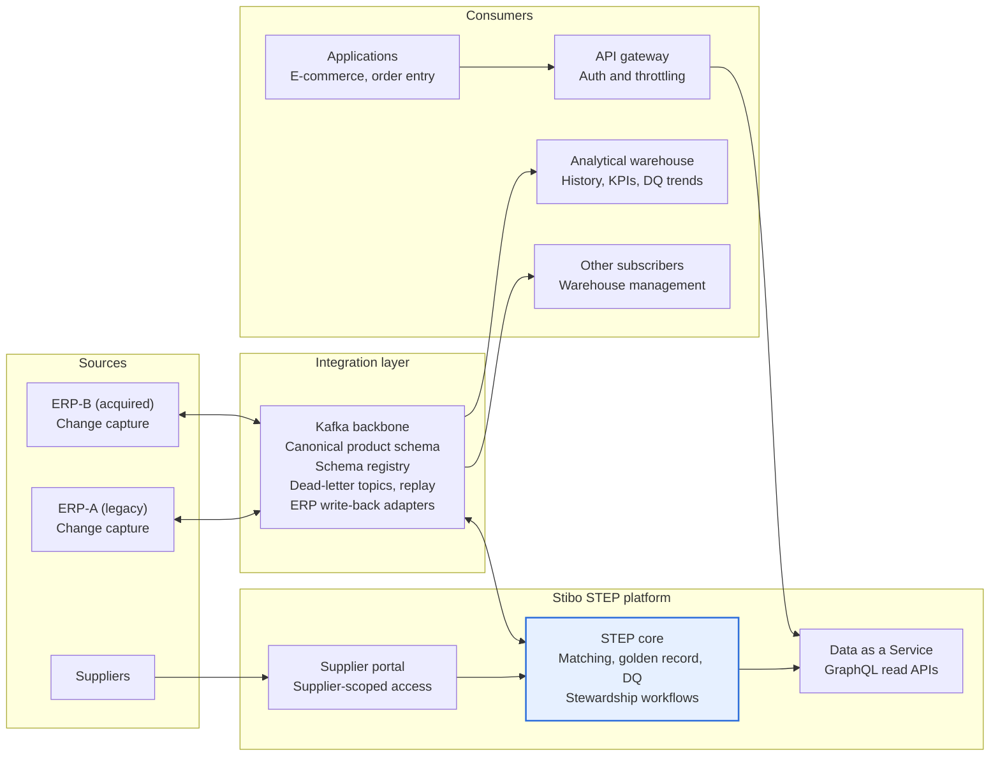

# Context diagram

STEP masters the data and hosts supplier onboarding; Kafka connects the ERPs and bulk consumers; DaaS serves on-demand reads.

ERPs publish changes in and receive golden data back through adapters on the backbone. Suppliers work in STEP's supplier portal. Applications query DaaS through the gateway, and bulk consumers such as the analytical warehouse subscribe to golden events.
