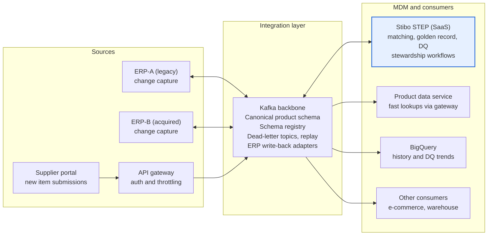

# Context diagram

STEP masters the data; Kafka connects every system to it. No source or consumer talks to STEP directly.

Sources publish changes in and receive golden data back through adapters on the backbone. STEP masters and governs. Consumers subscribe to golden events or read through the product data service.
